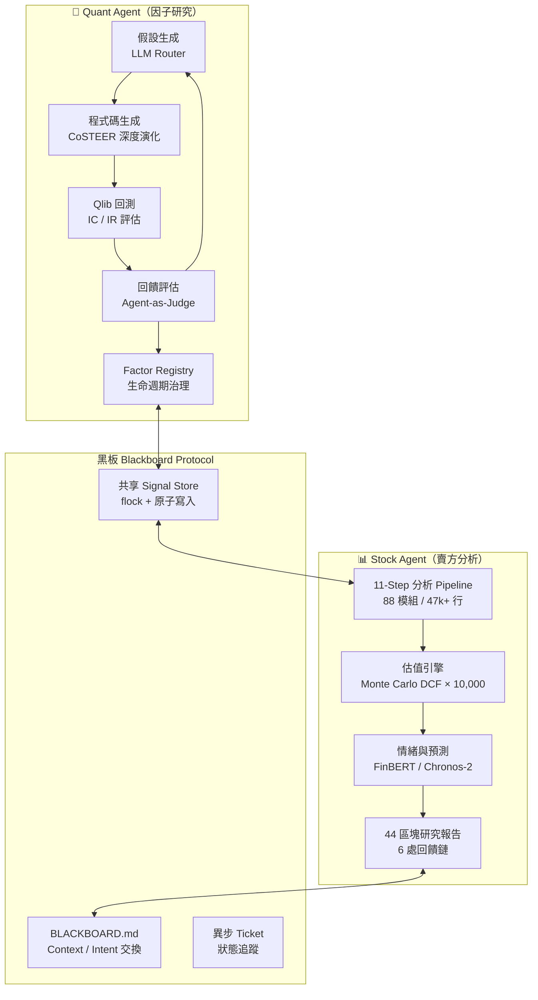

# Dual-Agent Quant Research System
## RD-Agent (因子研究) × Stock Agent (賣方分析) — 全自主 AI 量化研究基礎設施


> 兩個各自獨立演化的 AI Agent —— 一個做**量化因子研究**（RD-Agent × Qlib），
> 一個做**機構級股票分析**（Kronos 賣方分析師系統）—— 透過自製的 **Blackboard 通訊協定**
> 協作成一條全自動研究流水線。
>
> 本 repo 呈現**系統架構與工程設計**。策略邏輯、因子細節與參數基於智慧財產考量維持私有。

---

## 🏗️ 整體架構



兩個 Agent **程式碼完全隔離、各自有獨立 workspace**，所有共用資料
（因子訊號、回測快照、研究結論）只經過 Blackboard 與 Signal Store，
以檔案鎖＋原子替換保證併發一致性。

---

## 🤖 Quant Agent — LLM 全自動因子研究循環

以 [RD-Agent](https://github.com/microsoft/RD-Agent) + [Qlib](https://github.com/microsoft/qlib)
為基礎深度改造的**閉環因子挖掘系統**：

```
假設生成 → 程式碼生成 → Qlib 回測 → 回饋評判 → 知識庫沉積 →（循環）
```

### 特色工程

| 機制 | 設計 |
|------|------|
| **多階段 LLM 路由** | 假設生成走高推理模型、編碼與回饋走高效模型 —— 品質與成本兼得，API 逾時率大幅下降 |
| **CoSTEER 深度演化** | 每個假設自動演化 N 輪，配合全量知識庫採樣與歷史 trace 檢索 |
| **UCB Bandit 調度** | Multi-Armed Bandit 動態平衡「挖掘新因子 vs 調優模型」的探索收益 |
| **Agent-as-Judge 評判** | 回饋階段由多個 LLM 辯論判定實驗品質，避免單模型偏誤 |
| **因子 Registry 治理** | 生命週期管理：IC 去重（相關性閾值）、自動淘汰、數量硬上限、隔離區 |
| **AST 白名單驗證** | 因子表達式執行前的 AST 檢查，阻擋 eval/exec/子進程等危險呼叫 |
| **MemoryGuard** | 背景 RSS 監控執行緒，12GB 記憶體硬上限，防止 16GB 主機 OOM |
| **補丁重放系統** | `replay_patches.sh` 將本地補丁同步進 site-packages，升級後一鍵還原 |
| **雙軌系統** | 美股中大型股 Universe（2,655 檔）與加密貨幣單資產路線，各自有專屬 Prompt 約束 |

### 防偏設計（Quant Guardrails）

- 嚴格 **Train / OOS 時間軸硬隔離**，無前瞻偏差
- 單日向前收益率標籤，杜絕重疊窗口洩漏
- 損失函數雙軌：截面排序任務用 Learning-to-Rank，單資產路線自動切換回歸損失
- 資料源與標籤對齊經多層驗證（shift 語義、日曆長度標頭檢查工具）

---

## 📊 Stock Agent — 機構級賣方分析師系統（Kronos）

**~47,000 行 Python、88 個模組**，模擬投資銀行研究部的完整分析流程，
每日排程對 22 檔美股（跨 5 產業）產出 44 區塊的機構級研究報告。

### 核心能力

- **多方法估值交叉驗證**：DCF + P/E + EV/EBITDA + CROCI，≥3 方法一致才給評級
- **Monte Carlo DCF**：10,000 次模擬、5 變數機率分佈、PWERM 情境加權
- **FRED 動態 WACC**：無風險利率 + ERP + 信用利差即時計算
- **SEC EDGAR XBRL**：真實 10-K/10-Q 財報數據解析，自動識別 SBC / 商譽減損
- **FinBERT 情緒分析**：Apple Silicon GPU 加速，Loughran-McDonald 詞庫備援
- **Chronos-2 時序預測** + LightGBM 因子引擎 + Conformal Prediction 區間
- **6 處回饋鏈**：估值→預測→情緒→信心度的動態調整環路
- **Walk-Forward 驗證**：滾動窗口 OOS 測試，自動偵測過擬合
- **MiFID II 審計軌跡**：不可變雜湊標籤，符合歐盟金融法規
- **規則幻覺防禦**：Draft Mode Firewall，LLM 輸出全程規則護欄

---

## 🔗 協作層 — Blackboard 通訊協定

兩個 Agent 的協作不是靠一個大 prompt，而是**工程化的通訊協議**：

```
workspace-quant/          workspace-stocks/
├── BLACKBOARD.md   ◀────▶  高層級 Context / Intent 交換（原子更新腳本防截斷競態）
├── shared_states/  ◀────▶  TKT-*.json 異步任務派送與狀態追蹤
├── signal_store/   ◀────▶  共享因子訊號庫（flock 檔案鎖 + 原子替換）
└── factor_registry/index.json ◀──▶ 權威因子數據庫，雙端唯一事實源
```

**實戰案例**（節錄自協作日誌，皆為工程問題）：
- 訊號匯出掛死 18 小時 → 根因是 `find_file()` 遞迴 glob 掃整個 home（68k+ 目錄），
  修復＋watchdog 後 **5 天匯出 46 秒完成**
- SOTA 快照遭啟動清理誤刪 → glob 白名單修正 + 快照遷出清理路徑 + 雙寫鏡像過渡
- 下游 Agent 論文因子驗證受阻 → 發現代碼依賴衍生欄位 → 重構為自包含邏輯後覆驗
- 跨 Agent 獨立復現 paper trade 結果，日結算相關性 **1.000**（工程驗收級一致）

---

## 🛠️ Tech Stack

`Python` · `RD-Agent` · `Qlib` · `LightGBM` · `LanceDB` · `FinBERT` ·
`Chronos-2` · `GLM / Kimi / DeepSeek 多模型路由` · `launchd / cron 排程` ·
`Monte Carlo / Conformal Prediction` · `SEC EDGAR XBRL` · `flock / 原子寫入`

## 📫 Contact

ab410010066@gmail.com
